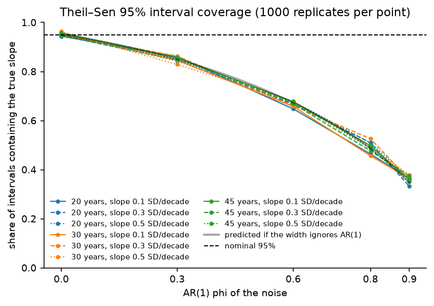

# Benchmark and calibrated verdict thresholds

Phase 2 of `project.md` (§3 validation (a)–(c), §5): run the Clerk and the
Examiner on synthetic series whose truth is known, report the
false-positive rate, interval coverage and power, and set the verdict
thresholds from them. The thresholds are in
[`trendcourt/thresholds.json`](../trendcourt/thresholds.json), read by
[`trendcourt/thresholds.py`](../trendcourt/thresholds.py). Gate 2 freezes them.

**Status:** waiting for the statistics reviewer's sign-off in issue #19.

## In plain words

* On noise with little memory from month to month, the trend test is close
  to honest: it "finds" a trend in about 5–7% of trend-free series at the
  5% level, and about 1–2% at the 1% level.
* The more each month resembles the last (autocorrelation, `phi`), the
  more often the test finds trends that are not there. At `phi = 0.9` it
  does so in about 30% of trend-free series at the 5% level. Soil moisture
  in all six regions, and temperature in the Amazon, are this persistent.
* The Theil–Sen 95% interval is too narrow whenever the noise is
  autocorrelated: it contains the true slope 85% of the time at
  `phi = 0.3` and 36% at `phi = 0.9`. The loss matches what the textbook
  AR(1) correction predicts almost exactly, so we use that correction
  wherever the interval decides a verdict.
* With 45 years of data and low autocorrelation, a trend of 0.2 noise
  standard deviations per decade is found almost every time; one of 0.1
  is found about 60–90% of the time. Persistent noise cuts that power,
  and the power curves at high `phi` are partly false positives.

So: the verdict keeps the proposed cut-offs (p < 0.01 for Strong,
p < 0.05 for Moderate) where the benchmark shows they work, demands more
where it shows they do not, and refuses to claim significance where no
cut-off we tested keeps false positives below 10%.

## Method

Code: [`trendcourt/benchmark.py`](../trendcourt/benchmark.py), driven by
[`scripts/benchmark.py`](../scripts/benchmark.py). Every replicate goes
through the same code path as a real case (`benchmark.run_case`, which
mirrors `trendcourt.examine`): `clerk.deseasonalize`, then
`examiner.theil_sen` (95%), `examiner.mk_hamed_rao` (`lag=3`) on the
anomalies and `examiner.mk_seasonal` on the raw series.

* **Series.** Monthly, starting January 1981, whole years: a seasonal cycle
  of amplitude 10, a linear trend, and stationary AR(1) noise of standard
  deviation 1 (600 burn-in steps). Because the noise SD is 1, a slope in
  units per decade is also a slope in noise SDs per decade, and the
  results carry over to any variable.
* **Grids.** `phi` in {0, 0.3, 0.6, 0.8, 0.9}. (a) FPR: no trend, 20, 30
  and 45 years. (b) Coverage: slopes 0.1, 0.3, 0.5 SD/decade, 20, 30, 45
  years. (c) Power: slopes 0.1, 0.2, 0.3, 0.5 SD/decade, 20 to 45 years in
  steps of 5.
* **Replicates and seeds.** 1000 per cell; each replicate's seed depends
  only on its cell and number (master seeds 17, 18, 19), so any replicate
  can be regenerated on its own. No replicate failed.
* **Uncertainty.** Every rate has an exact (Clopper–Pearson) 95% binomial
  interval. With 1000 replicates a rate near 0.05 is known to about ±0.014.
* **Real cases.** For the 18 cases, `benchmark.real_case_autocorr` gives the
  lag-1 autocorrelation of the anomalies before and after removing the
  Theil–Sen line (`r1`, `r1 detrended`). A real trend raises `r1`, so the
  detrended value is the better estimate of the noise's `phi`; it is the
  one the thresholds use. All 18 records cover 45 years (540 months).

Results: [`fpr.json`](benchmark/fpr.json),
[`coverage.json`](benchmark/coverage.json),
[`power.json`](benchmark/power.json). The figures and the tables below are
regenerated from those files, without rerunning the simulation, by

```bash
python scripts/benchmark.py --figures
```

## Figures

### False-positive rate against `phi`


Dashed: the nominal level. Shaded: the range of `r1 detrended` of the real
cases for each variable (precipitation 0.07–0.33, temperature 0.20–0.78,
soil moisture 0.68–0.89). The rate rises with `phi` at both levels, and
barely depends on record length.

### Coverage against `phi`



Dashed: 95%. The grey curve is the coverage of a nominal 95% interval
whose width ignores AR(1) noise, `2 Φ(1.96 / f) − 1` with
`f = sqrt((1 + phi) / (1 − phi))`. The observed points sit on it. Coverage
does not depend on the slope (Theil–Sen is shift-equivariant: adding a
line shifts every pairwise slope by the same amount) nor on the record
length, only on `phi`.

### Power against record length


One panel per `phi`, one line per slope (noise SDs per decade), shaded
95% intervals, at alpha 0.05. Dotted: the rate on trend-free series at
that `phi`. Where the dotted line is high, part of the "power" is the
test's own false positives.

## Where the tests hold and where they do not

* **Hamed–Rao holds at `phi` up to about 0.3.** At 0.05 the rate is
  0.044–0.057 at `phi = 0` and 0.067–0.074 at `phi = 0.3`, mildly inflated;
  at 0.01 it is 0.008–0.022. All precipitation cases and four of six
  temperature cases are in this range or just above it.
* **It drifts at `phi = 0.6`** (0.065–0.094 at 0.05, 0.018–0.025 at 0.01),
  still usable with the inflation stated.
* **It fails at `phi` of 0.8 and above.** At 0.05 it rejects 16% of
  trend-free series at `phi = 0.8` and 28–30% at 0.9; at 0.01, 5–7% and
  15–17%. These are the soil-moisture cases and Amazon temperature.
* **The correlated seasonal Mann–Kendall** is less liberal (0.21 at 0.05,
  `phi = 0.9`, 45 years) but still inflated. It is a consistency check in
  `project.md` §3, not the verdict test, and we keep it that way.
* **The Theil–Sen slope is close to unbiased** (mean and median estimates
  within 0.017 SD/decade of the injected slope in every cell), but **its interval only holds at `phi = 0`**. It covers 85% at 0.3,
  67% at 0.6, 49% at 0.8 and 36% at 0.9. `scipy.stats.theilslopes` builds
  the interval as if the residuals were independent; Table 3 shows that
  widening it by `sqrt((1 + phi) / (1 − phi))` accounts for the loss
  (needed 1.36, 2.02, 2.97, 4.17; factor 1.36, 2.00, 3.00, 4.36).
* **Power.** At `phi = 0` and 45 years the test finds 0.1 SD/decade 87% of
  the time at 0.05; at `phi = 0.6`, 39%. A 0.2 SD/decade trend needs about
  30 years to be found 90% of the time at `phi = 0`, and more than 45 at
  `phi = 0.6`.

## Decisions

Each decision is recorded in `trendcourt/thresholds.json`; no threshold
is hard-coded anywhere else. The verdict module (#20) reads them through
`trendcourt.thresholds` (`load`, `band_for`, `no_trend_allowed`).

### `alpha_strong = 0.01`, `alpha_moderate = 0.05`: kept, with caps by autocorrelation

The false-positive rate at the real cases' `phi` is near nominal only for
the least persistent records, so one global pair of cut-offs cannot be
right for all 18. Tightening the global alphas does not help the
persistent ones either: even at 0.01 the rate at `phi = 0.9` is 0.168. We
keep the proposed cut-offs as the default and attach the limit to the
record's autocorrelation, with an explicit policy:

* **Strong** may be given only where a trend-free series passes the Strong
  test less than 1 time in 20: worst-case FPR at `alpha_strong` ≤ 0.05
  (`fpr_policy.max_fpr_strong`).
* **Moderate** may be given only where a trend-free series passes the
  Moderate test at most 1 time in 10: FPR ≤ 0.10
  (`fpr_policy.max_fpr_moderate`). The Moderate cut-off is the larger of
  0.05 and 0.01 that meets this.
* Otherwise no significance claim: the verdict is capped at Inconclusive.

`trendcourt.thresholds.derive_bands` applies the policy to `fpr.json`
(a test checks that the committed bands are exactly its output):

* **`r1` ≤ 0.3: Strong allowed; Moderate at p < 0.05.** Kept α = 0.01 for
  Strong because the FPR at `phi = 0.3` is at most 0.022 [0.014, 0.033];
  kept α = 0.05 for Moderate because it is at most 0.074 [0.059, 0.092].
* **0.3 < `r1` ≤ 0.6: Strong allowed; Moderate at p < 0.05.** FPR at
  `phi = 0.6` at most 0.025 [0.016, 0.037] at 0.01 and 0.094 [0.077, 0.114]
  at 0.05.
* **0.6 < `r1` ≤ 0.8: capped at Moderate; Moderate needs p < 0.01.** At
  `phi = 0.8` the FPR at 0.01 is 0.070 [0.055, 0.088], above the Strong
  limit but within the Moderate one; at 0.05 it is 0.163, far above.
* **0.8 < `r1` ≤ 0.9: capped at Inconclusive.** At `phi = 0.9` the FPR is
  0.168 [0.145, 0.193] even at 0.01.
* **`r1` > 0.9:** outside the benchmark; Inconclusive.

Choices inside the policy, all leaning towards fewer false positives:

* A band takes the FPR of its **upper** grid `phi`, not the nearest, so it
  never understates the rate for a record inside it. (Sahel soil moisture,
  `r1 = 0.807`, falls in the 0.9 band.)
* The rate is the **worst over record lengths** (20, 30 and 45 years),
  because Phase 3 windows are shorter than the full record.
* The policy uses the **point estimate**. Using the upper end of the
  interval instead would move only one band (0.3–0.6 to Moderate at
  p < 0.01, as its interval at 0.05 reaches 0.114); we judged the point
  estimate plus the upper-`phi` rule conservative enough, and leave it to
  the statistics reviewer.

**Stated on the card.** Inside the allowed bands the test is still
somewhat liberal. The verdict card must state the band's FPR for the
verdict given (`hamed_rao_fpr` in the band), e.g. "trend-free records this
persistent pass this test about 7 times in 100".

### `window_agreement_strong = 0.80`: recorded as proposed, not yet calibrated

Recorded now so Phase 3 does not change the schema. The benchmark does
not test window agreement, and Phase 3 windows go down to 15 years, below
the shortest benchmarked record (20). It should be checked when the
window loop exists.

### `no_trend_margin`, per variable, on the widened interval

"No detectable trend" is allowed only when the Hamed–Rao p ≥
`alpha_moderate` (0.05, whatever the band's Moderate cut-off) **and** the
Theil–Sen interval, widened by `sqrt((1 + r1) / (1 − r1))` with `r1` the
detrended lag-1 autocorrelation, lies inside `[−margin, +margin]`. The
widening is needed because the raw interval is too narrow for every
real case (smallest `r1` 0.07): without it the rule would say "no trend"
too readily. In all three variables the margin is about 0.1 noise SD per
decade for a typical region, near the smallest slope the test finds
reliably with 45 years (Table 4), so "no detectable trend" means "any
trend is smaller than what this record could have shown".

| variable | margin | over 45 years | reasoning |
|---|---|---|---|
| temperature | 0.1 °C/decade | 0.45 °C | About half the global-mean surface warming rate since the late 1970s (about 0.2 °C/decade); a region warming less than that is not distinguishable from "no trend" on this record. Detrended anomaly SD in the six regions: 0.78–1.54 °C, so 0.06–0.13 SD/decade. |
| precipitation | 0.05 mm/day/decade | 0.23 mm/day | 18 mm/year per decade, about 2.6% per decade of the median regional mean (1.9 mm/day; range 0.36 in Mexicali to 5.9 in Manaus). Detrended anomaly SD: 0.46–1.87 mm/day, so 0.03–0.11 SD/decade. |
| soil moisture | 0.005 /decade | 0.0225 | POWER `GWETROOT` is root-zone wetness on a 0–1 scale. 0.005 is half a percentage point of wetness per decade, 1–2% of the regional means (0.27–0.77). Detrended anomaly SD: 0.025–0.080, so 0.06–0.20 SD/decade. |

Known weakness: one absolute precipitation margin is generous for arid
regions (0.05 mm/day/decade is 14% per decade of Mexicali's mean) and
strict for wet ones. The issue asks for a per-variable margin in mm/day;
a margin relative to the regional mean is a candidate change before
Gate 2, for the statistics reviewer to decide.

## Open points for the statistics reviewer

1. Point estimate or upper confidence bound in the FPR policy (see above).
2. The widened interval's coverage is predicted (normal approximation, Table
   3), not simulated directly; the prediction matches the raw coverage at
   every `phi`, and is slightly conservative at 0.9 (4.36 vs 4.17).
3. `r1` from a single record is itself uncertain, and biased low in short
   windows; band edges are sharp.
4. Only alpha 0.05 and 0.01 were simulated, so the Moderate cut-off can
   only move between those two.
5. The precipitation margin (absolute vs relative).

## Tables

<!-- tables:start (generated by scripts/benchmark.py --figures; do not edit) -->

### Table 1. False-positive rate on trend-free series

Rejection rate with its exact 95% binomial interval, 1000 replicates per row.

| phi | years | Hamed–Rao @0.05 | Hamed–Rao @0.01 | seasonal MK @0.05 | seasonal MK @0.01 | failed |
|---|---|---|---|---|---|---|
| 0 | 20 | 0.045 [0.033, 0.060] | 0.012 [0.006, 0.021] | 0.042 [0.030, 0.056] | 0.005 [0.002, 0.012] | 0 |
| 0 | 30 | 0.057 [0.043, 0.073] | 0.014 [0.008, 0.023] | 0.054 [0.041, 0.070] | 0.007 [0.003, 0.014] | 0 |
| 0 | 45 | 0.044 [0.032, 0.059] | 0.008 [0.003, 0.016] | 0.047 [0.035, 0.062] | 0.008 [0.003, 0.016] | 0 |
| 0.3 | 20 | 0.074 [0.059, 0.092] | 0.018 [0.011, 0.028] | 0.061 [0.047, 0.078] | 0.008 [0.003, 0.016] | 0 |
| 0.3 | 30 | 0.071 [0.056, 0.089] | 0.022 [0.014, 0.033] | 0.064 [0.050, 0.081] | 0.013 [0.007, 0.022] | 0 |
| 0.3 | 45 | 0.067 [0.052, 0.084] | 0.015 [0.008, 0.025] | 0.060 [0.046, 0.077] | 0.013 [0.007, 0.022] | 0 |
| 0.6 | 20 | 0.094 [0.077, 0.114] | 0.025 [0.016, 0.037] | 0.072 [0.057, 0.090] | 0.007 [0.003, 0.014] | 0 |
| 0.6 | 30 | 0.065 [0.051, 0.082] | 0.020 [0.012, 0.031] | 0.056 [0.043, 0.072] | 0.009 [0.004, 0.017] | 0 |
| 0.6 | 45 | 0.072 [0.057, 0.090] | 0.018 [0.011, 0.028] | 0.065 [0.051, 0.082] | 0.014 [0.008, 0.023] | 0 |
| 0.8 | 20 | 0.163 [0.141, 0.187] | 0.049 [0.036, 0.064] | 0.095 [0.078, 0.115] | 0.021 [0.013, 0.032] | 0 |
| 0.8 | 30 | 0.162 [0.140, 0.186] | 0.070 [0.055, 0.088] | 0.116 [0.097, 0.137] | 0.027 [0.018, 0.039] | 0 |
| 0.8 | 45 | 0.163 [0.141, 0.187] | 0.063 [0.049, 0.080] | 0.115 [0.096, 0.136] | 0.034 [0.024, 0.047] | 0 |
| 0.9 | 20 | 0.281 [0.253, 0.310] | 0.154 [0.132, 0.178] | 0.175 [0.152, 0.200] | 0.066 [0.051, 0.083] | 0 |
| 0.9 | 30 | 0.278 [0.250, 0.307] | 0.163 [0.141, 0.187] | 0.198 [0.174, 0.224] | 0.070 [0.055, 0.088] | 0 |
| 0.9 | 45 | 0.296 [0.268, 0.325] | 0.168 [0.145, 0.193] | 0.210 [0.185, 0.237] | 0.094 [0.077, 0.114] | 0 |

### Table 2. Theil–Sen 95% interval coverage

Share of 1000 intervals per cell that contain the injected slope (slopes in noise SDs per decade).

| phi | years | coverage, slope 0.1 | coverage, slope 0.3 | coverage, slope 0.5 | median width (SD/decade) |
|---|---|---|---|---|---|
| 0 | 20 | 0.944 [0.928, 0.957] | 0.947 [0.931, 0.960] | 0.954 [0.939, 0.966] | 0.441 |
| 0 | 30 | 0.953 [0.938, 0.965] | 0.951 [0.936, 0.964] | 0.963 [0.949, 0.974] | 0.241 |
| 0 | 45 | 0.958 [0.944, 0.970] | 0.947 [0.931, 0.960] | 0.949 [0.933, 0.962] | 0.132 |
| 0.3 | 20 | 0.861 [0.838, 0.882] | 0.846 [0.822, 0.868] | 0.843 [0.819, 0.865] | 0.441 |
| 0.3 | 30 | 0.846 [0.822, 0.868] | 0.863 [0.840, 0.884] | 0.829 [0.804, 0.852] | 0.241 |
| 0.3 | 45 | 0.856 [0.833, 0.877] | 0.857 [0.834, 0.878] | 0.850 [0.826, 0.872] | 0.132 |
| 0.6 | 20 | 0.648 [0.617, 0.678] | 0.666 [0.636, 0.695] | 0.678 [0.648, 0.707] | 0.441 |
| 0.6 | 30 | 0.658 [0.628, 0.687] | 0.661 [0.631, 0.690] | 0.679 [0.649, 0.708] | 0.241 |
| 0.6 | 45 | 0.677 [0.647, 0.706] | 0.669 [0.639, 0.698] | 0.677 [0.647, 0.706] | 0.132 |
| 0.8 | 20 | 0.464 [0.433, 0.495] | 0.510 [0.479, 0.541] | 0.510 [0.479, 0.541] | 0.433 |
| 0.8 | 30 | 0.457 [0.426, 0.488] | 0.526 [0.495, 0.557] | 0.492 [0.461, 0.523] | 0.239 |
| 0.8 | 45 | 0.498 [0.467, 0.529] | 0.477 [0.446, 0.508] | 0.487 [0.456, 0.518] | 0.131 |
| 0.9 | 20 | 0.365 [0.335, 0.396] | 0.333 [0.304, 0.363] | 0.366 [0.336, 0.397] | 0.425 |
| 0.9 | 30 | 0.364 [0.334, 0.395] | 0.360 [0.330, 0.391] | 0.379 [0.349, 0.410] | 0.235 |
| 0.9 | 45 | 0.360 [0.330, 0.391] | 0.375 [0.345, 0.406] | 0.351 [0.321, 0.381] | 0.130 |

### Table 3. Why coverage falls: the interval ignores autocorrelation

Coverage pooled over slopes and record lengths, the coverage an interval would have if its width ignored AR(1) noise, and the widening that brings it back to 95%.

| phi | coverage (all slopes and lengths) | predicted by AR(1) | widening needed for 95% | AR(1) factor sqrt((1+phi)/(1-phi)) |
|---|---|---|---|---|
| 0 | 0.952 | 0.950 | 0.99 | 1.00 |
| 0.3 | 0.850 | 0.850 | 1.36 | 1.36 |
| 0.6 | 0.668 | 0.673 | 2.02 | 2.00 |
| 0.8 | 0.491 | 0.486 | 2.97 | 3.00 |
| 0.9 | 0.361 | 0.347 | 4.17 | 4.36 |

### Table 4. Hamed–Rao power

Rejection rate at alpha 0.05 / 0.01, 1000 replicates per cell.

| phi | slope (SD/decade) | 20 yrs | 25 yrs | 30 yrs | 35 yrs | 40 yrs | 45 yrs |
|---|---|---|---|---|---|---|---|
| 0 | 0.1 | 0.15 / 0.04 | 0.25 / 0.10 | 0.36 / 0.19 | 0.53 / 0.30 | 0.70 / 0.49 | 0.87 / 0.67 |
| 0 | 0.2 | 0.45 / 0.22 | 0.72 / 0.46 | 0.89 / 0.72 | 0.99 / 0.94 | 1.00 / 0.99 | 1.00 / 1.00 |
| 0 | 0.3 | 0.76 / 0.54 | 0.96 / 0.87 | 1.00 / 0.98 | 1.00 / 1.00 | 1.00 / 1.00 | 1.00 / 1.00 |
| 0 | 0.5 | 0.99 / 0.96 | 1.00 / 1.00 | 1.00 / 1.00 | 1.00 / 1.00 | 1.00 / 1.00 | 1.00 / 1.00 |
| 0.3 | 0.1 | 0.13 / 0.04 | 0.14 / 0.05 | 0.28 / 0.11 | 0.37 / 0.17 | 0.47 / 0.26 | 0.60 / 0.37 |
| 0.3 | 0.2 | 0.28 / 0.11 | 0.48 / 0.28 | 0.70 / 0.47 | 0.86 / 0.66 | 0.96 / 0.87 | 0.99 / 0.97 |
| 0.3 | 0.3 | 0.54 / 0.33 | 0.79 / 0.57 | 0.96 / 0.87 | 1.00 / 0.98 | 1.00 / 1.00 | 1.00 / 1.00 |
| 0.3 | 0.5 | 0.91 / 0.78 | 0.99 / 0.98 | 1.00 / 1.00 | 1.00 / 1.00 | 1.00 / 1.00 | 1.00 / 1.00 |
| 0.6 | 0.1 | 0.11 / 0.03 | 0.13 / 0.05 | 0.18 / 0.09 | 0.25 / 0.12 | 0.29 / 0.13 | 0.39 / 0.21 |
| 0.6 | 0.2 | 0.20 / 0.08 | 0.30 / 0.13 | 0.47 / 0.26 | 0.62 / 0.39 | 0.77 / 0.55 | 0.86 / 0.71 |
| 0.6 | 0.3 | 0.36 / 0.17 | 0.54 / 0.34 | 0.76 / 0.55 | 0.90 / 0.78 | 0.98 / 0.93 | 1.00 / 0.98 |
| 0.6 | 0.5 | 0.70 / 0.50 | 0.92 / 0.78 | 0.98 / 0.95 | 1.00 / 1.00 | 1.00 / 1.00 | 1.00 / 1.00 |
| 0.8 | 0.1 | 0.17 / 0.07 | 0.18 / 0.09 | 0.22 / 0.10 | 0.26 / 0.14 | 0.29 / 0.16 | 0.34 / 0.19 |
| 0.8 | 0.2 | 0.24 / 0.10 | 0.29 / 0.16 | 0.35 / 0.18 | 0.47 / 0.30 | 0.57 / 0.38 | 0.72 / 0.53 |
| 0.8 | 0.3 | 0.28 / 0.15 | 0.45 / 0.27 | 0.60 / 0.42 | 0.73 / 0.57 | 0.85 / 0.73 | 0.94 / 0.85 |
| 0.8 | 0.5 | 0.54 / 0.35 | 0.75 / 0.56 | 0.92 / 0.81 | 0.98 / 0.94 | 1.00 / 0.99 | 1.00 / 1.00 |
| 0.9 | 0.1 | 0.28 / 0.15 | 0.31 / 0.18 | 0.30 / 0.18 | 0.33 / 0.18 | 0.36 / 0.21 | 0.40 / 0.27 |
| 0.9 | 0.2 | 0.31 / 0.18 | 0.39 / 0.24 | 0.43 / 0.27 | 0.47 / 0.32 | 0.56 / 0.39 | 0.62 / 0.50 |
| 0.9 | 0.3 | 0.36 / 0.21 | 0.47 / 0.32 | 0.55 / 0.41 | 0.65 / 0.52 | 0.76 / 0.63 | 0.84 / 0.74 |
| 0.9 | 0.5 | 0.49 / 0.35 | 0.68 / 0.53 | 0.79 / 0.66 | 0.89 / 0.82 | 0.97 / 0.94 | 0.99 / 0.98 |

### Table 5. Autocorrelation bands and verdict caps (`trendcourt/thresholds.json`)

FPR is the worst case over 20, 30 and 45 years at the band's benchmark phi.

| r1 range | benchmark phi | FPR @0.05 | FPR @0.01 | verdict cap | Moderate needs p < |
|---|---|---|---|---|---|
| (-1, 0.3] | 0.3 | 0.074 [0.059, 0.092] (20 yrs) | 0.022 [0.014, 0.033] (30 yrs) | strong | 0.05 |
| (0.3, 0.6] | 0.6 | 0.094 [0.077, 0.114] (20 yrs) | 0.025 [0.016, 0.037] (20 yrs) | strong | 0.05 |
| (0.6, 0.8] | 0.8 | 0.163 [0.141, 0.187] (20 yrs) | 0.070 [0.055, 0.088] (30 yrs) | moderate | 0.01 |
| (0.8, 0.9] | 0.9 | 0.296 [0.268, 0.325] (45 yrs) | 0.168 [0.145, 0.193] (45 yrs) | inconclusive | n/a |
| > 0.9 | outside the grid | not benchmarked | not benchmarked | inconclusive | n/a |

### Table 6. The 18 real cases

Lag-1 autocorrelation of the anomalies, before and after removing the Theil–Sen line; the band uses the detrended value.

| region | variable | r1 | r1 detrended | band | verdict cap | Moderate needs p < | interval widening |
|---|---|---|---|---|---|---|---|
| mexicali | temperature | 0.28 | 0.20 | (-1, 0.3] | strong | 0.05 | 1.22 |
| mexicali | precipitation | 0.21 | 0.20 | (-1, 0.3] | strong | 0.05 | 1.22 |
| mexicali | soil moisture | 0.80 | 0.79 | (0.6, 0.8] | moderate | 0.01 | 2.92 |
| mexico_city | temperature | 0.59 | 0.43 | (0.3, 0.6] | strong | 0.05 | 1.58 |
| mexico_city | precipitation | 0.13 | 0.13 | (-1, 0.3] | strong | 0.05 | 1.14 |
| mexico_city | soil moisture | 0.76 | 0.75 | (0.6, 0.8] | moderate | 0.01 | 2.67 |
| yucatan | temperature | 0.43 | 0.34 | (0.3, 0.6] | strong | 0.05 | 1.43 |
| yucatan | precipitation | 0.07 | 0.07 | (-1, 0.3] | strong | 0.05 | 1.07 |
| yucatan | soil moisture | 0.68 | 0.68 | (0.6, 0.8] | moderate | 0.01 | 2.27 |
| sahel | temperature | 0.34 | 0.33 | (0.3, 0.6] | strong | 0.05 | 1.41 |
| sahel | precipitation | 0.17 | 0.16 | (-1, 0.3] | strong | 0.05 | 1.18 |
| sahel | soil moisture | 0.83 | 0.81 | (0.8, 0.9] | inconclusive | n/a | 3.06 |
| amazon | temperature | 0.82 | 0.78 | (0.6, 0.8] | moderate | 0.01 | 2.86 |
| amazon | precipitation | 0.38 | 0.33 | (0.3, 0.6] | strong | 0.05 | 1.41 |
| amazon | soil moisture | 0.90 | 0.89 | (0.8, 0.9] | inconclusive | n/a | 4.14 |
| iberia | temperature | 0.29 | 0.21 | (-1, 0.3] | strong | 0.05 | 1.24 |
| iberia | precipitation | 0.16 | 0.15 | (-1, 0.3] | strong | 0.05 | 1.17 |
| iberia | soil moisture | 0.79 | 0.78 | (0.6, 0.8] | moderate | 0.01 | 2.87 |

<!-- tables:end -->

## Sign-off

Statistics reviewer (role A): pending, in issue #19.
