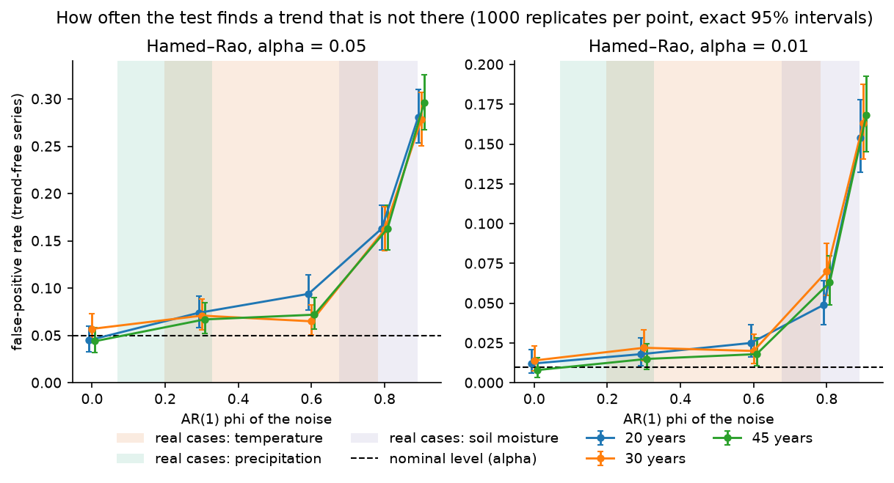
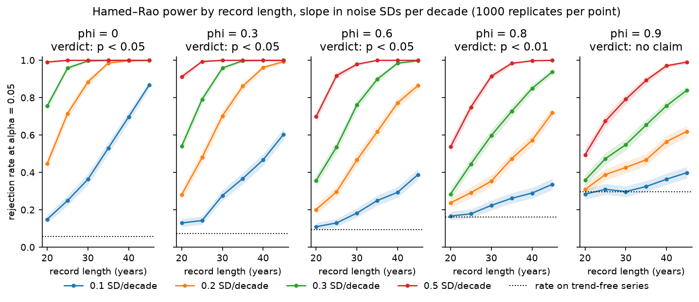

# Benchmark and calibrated verdict thresholds

Phase 2 of `project.md` (§3 validation (a)–(c), §5): run the Clerk and the
Examiner on synthetic series whose truth is known, report the
false-positive rate, interval coverage and power, and set the verdict
thresholds from them. The thresholds are in
[`trendcourt/thresholds.json`](../trendcourt/thresholds.json), read by
[`trendcourt/thresholds.py`](../trendcourt/thresholds.py). Gate 2 freezes them.

**Status:** signed off by the statistics reviewer (round 3, PASS, PR #31, commit `ed5d7e3`).

## In plain words

* On noise with little memory from month to month, the trend test is close
  to honest: it "finds" a trend in about 5–7% of trend-free series at the
  5% level, and about 1–2% at the 1% level.
* The more each month resembles the last (autocorrelation, `phi`), the
  more often the test finds trends that are not there. At `phi = 0.9` it
  does so in about 30% of trend-free series at the 5% level. The cause is
  known: the Hamed–Rao correction we use looks at only the first 3 lags of
  the autocorrelation (`lag=3`, chosen in PR #12), so with persistent noise
  it underestimates the variance (Table 1). Two of the 18
  real cases are this persistent (soil moisture in the Sahel and the
  Amazon); soil moisture elsewhere and Amazon temperature are at 0.68–0.79,
  at or below `phi = 0.8`, where the rate is about 16%.
* The Theil–Sen 95% interval is too narrow whenever the noise is
  autocorrelated: it contains the true slope 85% of the time at
  `phi = 0.3` and 36% at `phi = 0.9`. The loss matches what the textbook
  AR(1) correction predicts almost exactly, so we use that correction
  wherever the interval decides a verdict. With the correction computed
  from each record's own estimated autocorrelation, as the verdict will
  compute it, the widened interval covers 93–95% of the time on 45-year
  records, a little less (91–92%) on 20-year records at `phi = 0.9`
  (Tables 3 and 7).
* With 45 years of data and white noise, a trend of 0.2 noise standard
  deviations per decade is found almost every time and one of 0.1 87% of
  the time; at `phi = 0.3`, 0.1 is found 60% of the time, at `phi = 0.6`
  39%. Persistent noise cuts that power, and the power curves at high
  `phi` are partly false positives.
* Run end to end, as it will be applied to a real record (the band picked
  from the record's own, noisy estimate of its autocorrelation), the
  policy gives a false significance claim on at most 8% of trend-free
  AR(1) series and a false Strong claim on at most 2.5% (Table 7).
* AR(1) is a model. For soil moisture the real noise forgets faster than
  AR(1), so the tests are stricter than needed there; for four
  temperature and precipitation records it varies on multi-year scales
  more than AR(1) allows, so their stated false-positive rate and interval
  are optimistic, and their cards must say so (Table 8).

So: the verdict keeps the proposed cut-offs (p < 0.01 for Strong,
p < 0.05 for Moderate) where the benchmark shows they work, demands more
where it shows they do not, and refuses to claim significance where no
cut-off we tested keeps false positives below 10%.

## Method

Code: [`trendcourt/benchmark.py`](../trendcourt/benchmark.py), driven by
[`scripts/benchmark.py`](../scripts/benchmark.py). Every replicate goes
through the same code path as a real case (`benchmark.run_case`, which
mirrors `trendcourt.examine`): `clerk.deseasonalize`, then
`examiner.theil_sen` (95%), `examiner.mk_hamed_rao` (`lag=3`) on the
anomalies and `examiner.mk_seasonal` on the raw series.

* **Series.** Monthly, starting January 1981, whole years: a seasonal cycle
  of amplitude 10, a linear trend, and stationary AR(1) noise of standard
  deviation 1 (600 burn-in steps). Because the noise SD is 1, a slope in
  units per decade is also a slope in noise SDs per decade, so the results
  carry over to any variable **whose noise is close to AR(1)**. Table 8
  checks how close the 18 real records are (see "Does AR(1) describe the
  real noise?").
* **Grids.** `phi` in {0, 0.3, 0.6, 0.8, 0.9}. (a) FPR: no trend, 20, 30
  and 45 years. (b) Coverage: slopes 0.1, 0.3, 0.5 SD/decade, 20, 30, 45
  years; also the coverage of the widened interval, with `r1` estimated
  from each replicate. (c) Power: slopes 0.1, 0.2, 0.3, 0.5 SD/decade, 20
  to 45 years in steps of 5. (d) Policy as applied
  (`benchmark.applied_experiment`): no trend, true `phi` in {0, 0.3, 0.5,
  0.6, 0.7, 0.75, 0.8, 0.85, 0.9, 0.95} (on, between and above the band
  edges), 20, 30 and 45 years; each replicate is put in a band by its own
  `r1 detrended` and gets the claim its band allows
  (`thresholds.significance_claim`). (e) Real noise
  (`benchmark.noise_experiment`): per real case, an AR(p) model fitted to
  its detrended anomalies (Yule–Walker, order by AIC up to 12, on the
  residuals divided by their calendar-month SD), and the policy of (d) on
  trend-free records simulated from it. (d) and (e) skip the seasonal
  test, which the verdict does not read.
* **Replicates and seeds.** 1000 per cell; each replicate's seed depends
  only on its cell and number (master seeds 17, 18, 19, 20, 21; in (e)
  the cell is `zlib.crc32("region/variable")`), so any replicate can be
  regenerated on its own. No replicate failed.
* **Uncertainty.** Every rate has an exact (Clopper–Pearson) 95% binomial
  interval. With 1000 replicates a rate near 0.05 is known to about ±0.014.
* **Real cases.** For the 18 cases, `benchmark.real_case_autocorr` gives the
  lag-1 autocorrelation of the anomalies before and after removing the
  Theil–Sen line (`r1`, `r1 detrended`). A real trend raises `r1`, so the
  detrended value is the better estimate of the noise's `phi`; it is the
  one the thresholds use. All 18 records cover 45 years (540 months).

Results: [`fpr.json`](benchmark/fpr.json),
[`coverage.json`](benchmark/coverage.json),
[`power.json`](benchmark/power.json),
[`applied.json`](benchmark/applied.json),
[`noise.json`](benchmark/noise.json). The figures and the tables below are
regenerated from those files, without rerunning the simulation, by

```bash
python scripts/benchmark.py --figures
```

The no-trend columns of Table 6 are the one exception to "from those
files": they apply the rule to the real records, so `--figures` also
reads the committed POWER data in `data/` (through `clerk.prepare`; no
download, no simulation). The lag-3 columns of Table 1 are a closed-form
calculation. `--figures` also stops with an error if the bands in
`thresholds.json` are no longer what `derive_bands` gives on `fpr.json`,
if `noise_caveats` are no longer what `derive_noise_caveats` gives on
`noise.json`, or if `applied.json` or `noise.json` were run with other
thresholds.

## Figures

### False-positive rate against `phi`



Dashed: the nominal level. Shaded: the range of `r1 detrended` of the real
cases for each variable (precipitation 0.07–0.33, temperature 0.20–0.78,
soil moisture 0.68–0.89). The rate rises with `phi` at both levels, and
barely depends on record length.

### Coverage against `phi`


Dashed: 95%. The grey curve is the coverage of a nominal 95% interval
whose width ignores AR(1) noise, `2 Φ(1.96 / f) − 1` with
`f = sqrt((1 + phi) / (1 − phi))`. The observed points sit on it. Coverage
does not depend on the slope (Theil–Sen is shift-equivariant: adding a
line shifts every pairwise slope by the same amount) nor on the record
length, only on `phi`. The square markers are the interval widened as the
no-trend rule widens it, with `r1` estimated from each replicate (pooled
over slopes): close to 95% at every `phi` on 45-year records, and a
little lower on 20-year records at `phi = 0.9` (Table 3).

### Power against record length



One panel per `phi`, one line per slope (noise SDs per decade), shaded
95% intervals, at alpha 0.05. Dotted: the rate on trend-free series at
that `phi`. Where the dotted line is high, part of the "power" is the
test's own false positives. **The curves are at 0.05 in every panel, but
the verdict does not use 0.05 everywhere:** each panel title gives the
cut-off it does use for a record with that `r1` (p < 0.05 up to 0.6,
p < 0.01 at 0.8, no claim at 0.9). The power at the operative cut-off is
in bold in Table 4; at `phi = 0.9` none of it is usable (e.g. the 0.40
for 0.1 SD/decade at 45 years), because the verdict makes no
significance claim there.

## Where the tests hold and where they do not

* **Hamed–Rao holds at `phi` up to about 0.3.** At 0.05 the rate is
  0.044–0.057 at `phi = 0` and 0.067–0.074 at `phi = 0.3`, mildly inflated;
  at 0.01 it is 0.008–0.022. All precipitation cases and four of six
  temperature cases are in this range or just above it.
* **It drifts at `phi = 0.6`** (0.065–0.094 at 0.05, 0.018–0.025 at 0.01),
  still usable with the inflation stated.
* **It fails at `phi` of 0.8 and above, because its correction uses only
  3 lags.** At 0.05 it rejects 16% of trend-free series at `phi = 0.8`
  and 28–30% at 0.9; at 0.01, 5–7% and 15–17%. This is not a property of
  Mann–Kendall as such. `examiner.mk_hamed_rao` uses `lag=3` (PR #12: with
  every lag eligible the correction picks up spurious lags on white noise
  and can turn Var(S) negative), and with persistent noise the first 3
  lags miss most of the autocorrelation. For AR(1) noise and 540 months
  the 3-lag variance is 0.96, 0.84, 0.56 and 0.33 of the all-lag variance
  at `phi` 0.3, 0.6, 0.8 and 0.9, which alone predicts rejection rates at
  0.05 of 0.055, 0.072, 0.143 and 0.261 (Table 1, closed form), close to
  the simulated rates. Sahel (0.81) and Amazon (0.89) soil moisture are in this range;
  Mexicali, Iberia and Mexico City soil moisture and Amazon temperature
  (0.75–0.79) are just below 0.8, and Yucatán soil moisture is at 0.68.
* **The correlated seasonal Mann–Kendall** is less liberal (0.21 at 0.05,
  `phi = 0.9`, 45 years) but still inflated. It is a consistency check in
  `project.md` §3, not the verdict test, and we keep it that way.
* **The Theil–Sen slope is close to unbiased** (mean and median estimates
  within 0.017 SD/decade of the injected slope in every cell), but **its interval only holds at `phi = 0`**. It covers 85% at 0.3,
  67% at 0.6, 49% at 0.8 and 36% at 0.9. `scipy.stats.theilslopes` builds
  the interval as if the residuals were independent; Table 3 shows that
  widening it by `sqrt((1 + phi) / (1 − phi))` accounts for the loss
  (needed 1.36, 2.02, 2.97, 4.17; factor 1.36, 2.00, 3.00, 4.36). That
  comparison uses the true `phi`. The verdict widens with `r1` estimated
  from the record, which is biased low, and the factor is convex in `r1`,
  so the factor actually applied is a little smaller on average. Simulated
  that way (Table 3, last columns, and Table 7), the widened interval
  covers 0.93–0.95 on 45-year records at every `phi` up to 0.9, but only
  0.91–0.92 on 20-year records at `phi = 0.9` (0.912 in Table 3, 0.917 in
  Table 7; 0.92–0.93 at 0.8–0.85; the statistics reviewer's independent
  run gave 0.90).
* **Power.** At `phi = 0` and 45 years the test finds 0.1 SD/decade 87% of
  the time at 0.05; at `phi = 0.6`, 39%. A 0.2 SD/decade trend needs about
  30 years to be found 90% of the time at `phi = 0`, and more than 45 at
  `phi = 0.6`. These are rates at 0.05. At `phi = 0.8` the verdict needs
  p < 0.01, where the power is lower (0.53 for 0.2 SD/decade at 45
  years), and at 0.9 it makes no claim at all (Table 4 marks the operative
  cut-off).

## Does AR(1) describe the real noise?

The bands and the interval widening are calibrated on AR(1) noise. Table 8
checks that against each real record: the autocorrelation of its
detrended anomalies at lags 2, 3, 6 and 12 against `r1^k`, the variance
inflation those autocorrelations imply, and an AR(p) model fitted to the
record and used to simulate 1000 trend-free records on which the policy is
applied end to end. The error goes both ways:

* **Soil moisture forgets faster than AR(1): the rule is conservative.**
  At lag 6 the observed autocorrelation is about 0 in Mexicali, the Sahel
  and Iberia where AR(1) predicts 0.23–0.28, and lower than AR(1) in the
  other three; the observed variance inflation is 0.4–0.9 of the AR(1)
  value with the same weights. Under each record's own noise model the
  false-claim rate is at most 0.080 and the widened interval covers
  0.94–0.99. The AR(1) widening is wider than these records need (2.0–3.7
  needed against 2.3–4.1 applied).
* **Four temperature and precipitation records vary on multi-year scales:
  the rule is optimistic for them.** Under their own noise models: Amazon
  precipitation covers 0.879 (false claims 0.094), Yucatán precipitation
  0.913, Yucatán temperature 0.892, Mexico City temperature 0.796 with
  false claims 0.187 and FPR 0.089 at 0.01. Much of the Mexico City
  figure is residual nonlinear warming that the straight Theil–Sen line
  leaves in the residuals, not noise; its p is below 0.001, so no verdict
  depends on it.
* **No current verdict changes**, and no threshold changes: every case
  near "no trend" or near a cut-off is either well described by AR(1) or
  conservative. Mexico City precipitation, the one case for which "No
  detectable trend" is allowed, covers 0.946 under its own noise.

These four cases are flagged in `thresholds.json` (`noise_caveats`, rule
`noise_model_check`, rebuilt from `noise.json` by
`thresholds.derive_noise_caveats`): `interval_optimistic` when the widened
interval covers less than 0.93 under the case's own noise, `fpr_optimistic`
when the false-claim (or false-Strong) rate is above the band's stated
rate beyond Monte Carlo error. The verdict module reads them with
`thresholds.noise_caveat(region, variable)`; `no_trend_allowed` refuses
"No detectable trend" for every `interval_optimistic` case (see the
no-trend rule below); and **the card of a flagged
case must print `noise_model_check.card_text`**: the record varies on
multi-year scales more than the benchmark's noise model assumes, so the
stated false-positive rate and interval are optimistic. The flags live in
`thresholds.json` next to the bands, rather than in a separate file,
because `verdict.decide(case, thresholds)` (#20) receives only the
thresholds; like the bands, they are derived from a committed result and a
test checks they are exactly that derivation. ENSO-scale variability,
which `project.md` §3 names as a confounder, is the obvious candidate
source for the slow decay in the tropical records.

## Decisions

Each decision is recorded in `trendcourt/thresholds.json`; no threshold
is hard-coded anywhere else. The verdict module (#20) reads them through
`trendcourt.thresholds` (`load`, `band_for`, `no_trend_allowed`).

### `alpha_strong = 0.01`, `alpha_moderate = 0.05`: kept, with caps by autocorrelation

The false-positive rate at the real cases' `phi` is near nominal only for
the least persistent records, so one global pair of cut-offs cannot be
right for all 18. Tightening the global alphas does not help the
persistent ones either: even at 0.01 the rate at `phi = 0.9` is 0.168. We
keep the proposed cut-offs as the default and attach the limit to the
record's autocorrelation, with an explicit policy:

* **Strong** may be given only where a trend-free series passes the Strong
  test less than 1 time in 20: worst-case FPR at `alpha_strong` ≤ 0.05
  (`fpr_policy.max_fpr_strong`).
* **Moderate** may be given only where a trend-free series passes the
  Moderate test at most 1 time in 10: FPR ≤ 0.10
  (`fpr_policy.max_fpr_moderate`). The Moderate cut-off is the larger of
  0.05 and 0.01 that meets this.
* Otherwise no significance claim: the verdict is capped at Inconclusive.

`trendcourt.thresholds.derive_bands` applies the policy to `fpr.json`
(a test checks that the committed bands are exactly its output):

* **`r1` ≤ 0.3: Strong allowed; Moderate at p < 0.05.** Kept α = 0.01 for
  Strong because the FPR at `phi = 0.3` is at most 0.022 [0.014, 0.033];
  kept α = 0.05 for Moderate because it is at most 0.074 [0.059, 0.092].
* **0.3 < `r1` ≤ 0.6: Strong allowed; Moderate at p < 0.05.** FPR at
  `phi = 0.6` at most 0.025 [0.016, 0.037] at 0.01 and 0.094 [0.077, 0.114]
  at 0.05.
* **0.6 < `r1` ≤ 0.8: capped at Moderate; Moderate needs p < 0.01.** At
  `phi = 0.8` the FPR at 0.01 is 0.070 [0.055, 0.088], above the Strong
  limit but within the Moderate one; at 0.05 it is 0.163, far above.
* **0.8 < `r1` ≤ 0.9: capped at Inconclusive.** At `phi = 0.9` the FPR is
  0.168 [0.145, 0.193] even at 0.01.
* **`r1` > 0.9:** outside the benchmark; Inconclusive, and never "No
  detectable trend" either (see the no-trend rule below).

Choices inside the policy, all leaning towards fewer false positives:

* A band takes the FPR of its **upper** grid `phi`, not the nearest, so it
  never understates the rate for a record inside it. (Sahel soil moisture,
  `r1 = 0.807`, falls in the 0.9 band.)
* The rate is the **worst over record lengths** (20, 30 and 45 years),
  because Phase 3 windows are shorter than the full record.
* The policy uses the **point estimate**. Using the upper end of the
  interval instead would change only one band: in 0.3–0.6 the Moderate
  cut-off would become p < 0.01, as its interval at 0.05 reaches 0.114;
  its cap would stay Strong, as its interval at 0.01 reaches only 0.037
  (≤ 0.05). The point estimate plus the upper-`phi` rule is conservative
  enough: as applied (below), no false-claim rate exceeds 0.080. The
  statistics reviewer accepted it (issue #19, round 1).

**The policy as applied (Table 7).** The bands are set from the rate at
the grid `phi`, but a real record is put in a band by its *estimated*
`r1`, which is noisy (SD 0.02–0.07) and biased low (by up to −0.024 on
20-year records), and its true `phi` can lie anywhere between the grid
points. Table 7 runs the whole rule that way on trend-free AR(1) series,
with true `phi` on, between and above the band edges (0, 0.3, 0.5, 0.6,
0.7, 0.75, 0.8, 0.85, 0.9, 0.95) and 20, 30 and 45 years:

* false significance claims at most **0.080** [0.064, 0.099] (`phi` 0.3
  at 20 years and 0.5 at 45 years), within the 0.10 limit; at `phi`
  0.7–0.85 they are 0.004–0.054, because those records mostly land in the
  stricter (0.6, 0.8] or (0.8, 0.9] bands;
* false Strong claims at most **0.025** [0.016, 0.037], within the 0.05
  limit;
* above the grid (`phi = 0.95`) at most 0.003.

So the sharp band edges, the plug-in `r1` and its downward bias do not
break the limits under AR(1) noise: the upper-`phi` rule absorbs them. The
larger risk is that the real noise is not AR(1) (Table 8, previous
section).

**Stated on the card.** Inside the allowed bands the test is still
somewhat liberal. The verdict card must state the band's FPR for the
verdict given (`hamed_rao_fpr` in the band), e.g. "trend-free records this
persistent pass this test about 7 times in 100".

### `window_agreement_strong = 0.80`: recorded as proposed, not yet calibrated

Recorded now so Phase 3 does not change the schema. The benchmark does
not test window agreement, and Phase 3 windows go down to 15 years, below
the shortest benchmarked record (20). It should be checked when the
window loop exists.

### `no_trend_margin`, per variable, on the widened interval

"No detectable trend" is allowed only when the Hamed–Rao p ≥
`alpha_moderate` (0.05, whatever the band's Moderate cut-off) **and** the
Theil–Sen interval, widened by `sqrt((1 + r1) / (1 − r1))` with `r1` the
detrended lag-1 autocorrelation, lies inside `[−margin, +margin]`. The
widening is needed because the raw interval is too narrow for every
real case (smallest `r1` 0.07): without it the rule would say "no trend"
too readily. In all three variables the margin is of the order of 0.1
noise SD per decade or less for a typical region. With 45 years that is
near the smallest slope the test finds reliably **only for nearly white
noise** (0.1 SD/decade is found 87% of the time at `phi = 0`, 60% at 0.3
and 39% at 0.6, Table 4); for more persistent records the margin is
below what the record could reliably have detected, which is one more
reason the rule rarely fires. So "no detectable trend" means "any trend
is smaller than a relevant size", and on persistent records the widened
interval decides whether the record can show that.

Where the rule applies, by autocorrelation band:

* **`r1` inside the benchmark (≤ 0.9), including the (0.8, 0.9] band.**
  "No detectable trend" stays allowed there, even though that band is
  capped at Inconclusive for significance claims. The cap is about the
  false-positive rate of the significance test; the no-trend rule rests on
  the widened interval. Simulated as applied, with `r1` estimated from each
  record (Table 3, last columns; Table 7), the widened interval covers
  0.932 [0.915, 0.947] at `phi = 0.9` and 0.944 at 0.85 on 45-year
  records, close to the nominal 0.95, which is enough to keep the rule
  there for the full records. (The earlier statement that the factor is
  "slightly conservative" at 0.9 compared the factor at the true `phi`,
  4.36, with the 4.17 needed; with the estimated `r1` the mean factor
  applied is 4.21 (4.09 on 20-year records) and the advantage disappears.)
* **Phase 3 caveat.** On 20-year records the widened coverage falls to
  0.912 [0.901, 0.922] at `phi = 0.9` (Table 3, 3000 replicates; 0.917 in
  Table 7) and 0.929 at 0.85 (the reviewer's independent run: 0.898 at
  0.9). **Phase 3 must not reuse this rule
  unchanged for windows of 20 years or less with `r1` in (0.8, 0.9].**
* **`r1` above the benchmark (> 0.9): never.** The widening was not
  checked there (coverage with estimated `r1` falls to 0.875–0.920 at
  `phi = 0.95`), so `no_trend_allowed` returns False and the verdict is
  Inconclusive.
* **Cases flagged `interval_optimistic`: never** (Table 8). Under their
  own noise the widened interval covers less than 0.93, too little to
  support a claim of absence. `no_trend_allowed` enforces this: it takes
  `region` as a required keyword and returns False for a flagged case.
  The guard matters on the committed data. Yucatán precipitation is not
  significant (p = 0.498) and geometrically reachable (widened half-width
  0.0846 against a margin of 0.0872); today it is refused only because
  its slope is off-centre, and a centred slope would pass without the
  guard. With the widening its own noise model calls for (1.29 instead of
  1.07) it would not be reachable at all. No current verdict changes.

| variable | margin | over 45 years | reasoning |
|---|---|---|---|
| temperature | 0.1 °C/decade | 0.45 °C | About half the global-mean surface warming rate since the late 1970s (about 0.2 °C/decade); a region warming less than that is not distinguishable from "no trend" on this record. Detrended anomaly SD in the six regions: 0.78–1.54 °C, so 0.06–0.13 SD/decade. |
| precipitation | 3% of the regional mean per decade (`relative_to_mean = 0.03`) | 13.5% of the mean | Precipitation change is judged relative to the local mean: a 0.05 mm/day/decade change is 14% per decade in Mexicali (mean 0.36 mm/day) and 0.8% in the Amazon (5.9 mm/day). The margin is `0.03 × regional mean` mm/day/decade, the regional mean being the mean of the case's 12 monthly climatology values (the climatology's own base period, the whole record; `thresholds.regional_mean`). Per region: Mexicali 0.011, Iberia 0.036, Sahel 0.044, Mexico City 0.070, Yucatán 0.087, Amazon 0.178 mm/day/decade, i.e. 0.02–0.10 detrended-anomaly SD per decade. Why 3%: a "no trend" claim should rule out a change of about a tenth or more of the mean over the record (13.5% over 45 years), roughly the size of regional precipitation changes treated as relevant in impact assessments. 5% (22.5% over 45 years) would let a large drying be called "no trend". Why not `min(0.05, 0.03 × mean)`: the cap would bind only in the three wettest regions and give them a different, stricter meaning; one relative definition means the same everywhere. |
| soil moisture | 0.005 /decade | 0.0225 | POWER `GWETROOT` is root-zone wetness on a 0–1 scale, already a fraction, so the margin stays absolute. 0.005 is half a percentage point of wetness per decade, about 0.65–1.9% of the regional means (0.27–0.77). Detrended anomaly SD: 0.025–0.080, so 0.06–0.20 SD/decade. |

The formula and its parameter are in `thresholds.json`
(`no_trend_margin.precipitation = {"relative_to_mean": 0.03}`,
`no_trend_margin_formula`); `thresholds.no_trend_margin` and
`no_trend_allowed` take the case's `regional_mean` and refuse a
precipitation call without it.

**Decision: the margins stay as above; on these records "No detectable
trend" is rare, and that is intended.** The margins are set from what
counts as a relevant trend (above), not to make the rule fire. With
45-year records and the honest, widened interval, the interval is often
wider than the margin even at a slope of exactly 0, so the verdict on a
non-significant record will usually be Inconclusive rather than "no
detectable trend". That is the intended conservative behaviour: the tool
does not claim the absence of a trend that the record could not have
shown. Table 6 records the effect on the 18 cases (widened half-width,
margin, whether "no trend" is reachable at all, and whether it is allowed
now):

* "No trend" is **not reachable at any slope** for 9 of 18 cases:
  temperature in Mexicali, the Amazon and Iberia; precipitation in
  Mexicali and Iberia; soil moisture in Mexico City, Yucatán, the Amazon
  and Iberia. The relative precipitation margin made Mexicali (widened
  half-width 0.022 against 0.011) unreachable, and Yucatán and Amazon
  precipitation geometrically reachable; both are flagged
  `interval_optimistic`, so `no_trend_allowed` refuses them at any slope.
* It is **allowed for one**: Mexico City precipitation (p = 0.67; widened
  interval about [−0.058, +0.037] mm/day/decade, inside ±0.070, i.e. at
  most a 2.5% per decade change either way). Its noise is close to AR(1)
  (widened coverage 0.946 under its own noise model, Table 8), so the
  claim is supported: any widening factor up to 1.42 keeps the interval
  inside the margin, against 1.21 called for by its own AR(p) model. The
  card should state the margin in the user's terms: any trend is smaller
  than about 2.5% of the mean per decade. The other five non-significant
  cases (precipitation in Yucatán and Iberia, soil moisture in Mexico
  City, Yucatán and Iberia) get Inconclusive; for Yucatán precipitation
  the `interval_optimistic` guard refuses it even if its slope were
  centred.
* For soil moisture, part of the unreachability comes from the model, not
  the data: the AR(1) widening is wider than the records' own
  autocorrelation implies (Table 8: 2.0–3.7 needed against 2.3–4.1
  applied), so the soil-moisture intervals are wider than necessary.
* Phase 3 windows (down to 15 years) have wider intervals still, so there
  the rule will fire even less.

## Open points: decisions after review round 1

The statistics reviewer's round 1 (issue #19) decided the seven points
left open for review. Recorded here with what changed:

1. **Point estimate vs upper bound in the FPR policy: kept as is.** The
   upper-`phi` rule absorbs the Monte Carlo error: as applied (Table 7) no
   false-claim rate exceeds 0.080 and no false-Strong rate 0.025. The
   upper bound would only move the 0.3–0.6 Moderate cut-off to 0.01, at a
   real cost in power.
2. **Widened coverage: now simulated, not predicted.** The coverage with
   `r1` estimated per record is in Table 3 and Table 7. It is about 0.93–
   0.95 at `phi` 0.85–0.9 on 45-year records (the no-trend rule stays
   allowed in (0.8, 0.9]), and about 0.91–0.92 on 20-year windows there, so
   Phase 3 must not reuse the rule unchanged for such windows. The
   "slightly conservative at 0.9" statement is withdrawn.
3. **Uncertainty of `r1`, short-record bias, sharp band edges: closed by
   Table 7.** The end-to-end simulation keeps the 0.10 and 0.05 limits
   under AR(1) noise. The larger risk, misfit of the AR(1) model, is
   covered by Table 8 and the `noise_caveats`.
4. **Only alphas 0.05 and 0.01: kept as is.** The restriction only makes
   the (0.6, 0.8] band more conservative (FPR 0.070 at its cut-off against
   a limit of 0.10).
5. **Precipitation margin: now relative**, 3% of the regional mean per
   decade (above).
6. **"No detectable trend" mostly unreachable: kept as is.** A claim of
   absence needs precision these records do not have, and Inconclusive is
   the safe outcome. With the relative precipitation margin it is now
   unreachable for 9 of 18 cases and allowed for one. For soil moisture,
   the AR(1) widening is wider than the records' own autocorrelation
   implies (Table 8), so part of the unreachability there comes from the
   noise model, not the data.
7. **`max_fpr_strong = 0.05`: kept as is.** Where Strong is allowed the
   rate is 0.022–0.025, at most 0.025 as applied, and Strong also needs
   window and witness agreement, which only lowers it. The card states the
   band's rate.

## Tables

<!-- tables:start (generated by scripts/benchmark.py --figures; do not edit) -->

### Table 1. False-positive rate on trend-free series

Rejection rate with its exact 95% binomial interval, 1000 replicates per row. The two middle columns are a closed-form calculation, not simulated: the ratio of the variance the Hamed–Rao correction computes with only 3 lags (after its significance filter) to the variance with every lag, for AR(1) noise, and the rejection rate that ratio alone predicts.

| phi | years | Hamed–Rao @0.05 | Hamed–Rao @0.01 | lag-3 variance ratio | predicted by lag-3 truncation @0.05 / @0.01 | seasonal MK @0.05 | seasonal MK @0.01 | failed |
|---|---|---|---|---|---|---|---|---|
| 0 | 20 | 0.045 [0.033, 0.060] | 0.012 [0.006, 0.021] | 1.00 | 0.050 / 0.010 | 0.042 [0.030, 0.056] | 0.005 [0.002, 0.012] | 0 |
| 0 | 30 | 0.057 [0.043, 0.073] | 0.014 [0.008, 0.023] | 1.00 | 0.050 / 0.010 | 0.054 [0.041, 0.070] | 0.007 [0.003, 0.014] | 0 |
| 0 | 45 | 0.044 [0.032, 0.059] | 0.008 [0.003, 0.016] | 1.00 | 0.050 / 0.010 | 0.047 [0.035, 0.062] | 0.008 [0.003, 0.016] | 0 |
| 0.3 | 20 | 0.074 [0.059, 0.092] | 0.018 [0.011, 0.028] | 0.87 | 0.068 / 0.016 | 0.061 [0.047, 0.078] | 0.008 [0.003, 0.016] | 0 |
| 0.3 | 30 | 0.071 [0.056, 0.089] | 0.022 [0.014, 0.033] | 0.87 | 0.068 / 0.016 | 0.064 [0.050, 0.081] | 0.013 [0.007, 0.022] | 0 |
| 0.3 | 45 | 0.067 [0.052, 0.084] | 0.015 [0.008, 0.025] | 0.96 | 0.055 / 0.012 | 0.060 [0.046, 0.077] | 0.013 [0.007, 0.022] | 0 |
| 0.6 | 20 | 0.094 [0.077, 0.114] | 0.025 [0.016, 0.037] | 0.85 | 0.071 / 0.018 | 0.072 [0.057, 0.090] | 0.007 [0.003, 0.014] | 0 |
| 0.6 | 30 | 0.065 [0.051, 0.082] | 0.020 [0.012, 0.031] | 0.85 | 0.071 / 0.018 | 0.056 [0.043, 0.072] | 0.009 [0.004, 0.017] | 0 |
| 0.6 | 45 | 0.072 [0.057, 0.090] | 0.018 [0.011, 0.028] | 0.84 | 0.072 / 0.018 | 0.065 [0.051, 0.082] | 0.014 [0.008, 0.023] | 0 |
| 0.8 | 20 | 0.163 [0.141, 0.187] | 0.049 [0.036, 0.064] | 0.57 | 0.139 / 0.052 | 0.095 [0.078, 0.115] | 0.021 [0.013, 0.032] | 0 |
| 0.8 | 30 | 0.162 [0.140, 0.186] | 0.070 [0.055, 0.088] | 0.56 | 0.141 / 0.053 | 0.116 [0.097, 0.137] | 0.027 [0.018, 0.039] | 0 |
| 0.8 | 45 | 0.163 [0.141, 0.187] | 0.063 [0.049, 0.080] | 0.56 | 0.143 / 0.054 | 0.115 [0.096, 0.136] | 0.034 [0.024, 0.047] | 0 |
| 0.9 | 20 | 0.281 [0.253, 0.310] | 0.154 [0.132, 0.178] | 0.35 | 0.249 / 0.130 | 0.175 [0.152, 0.200] | 0.066 [0.051, 0.083] | 0 |
| 0.9 | 30 | 0.278 [0.250, 0.307] | 0.163 [0.141, 0.187] | 0.34 | 0.256 / 0.136 | 0.198 [0.174, 0.224] | 0.070 [0.055, 0.088] | 0 |
| 0.9 | 45 | 0.296 [0.268, 0.325] | 0.168 [0.145, 0.193] | 0.33 | 0.261 / 0.140 | 0.210 [0.185, 0.237] | 0.094 [0.077, 0.114] | 0 |

### Table 2. Theil–Sen 95% interval coverage

Share of 1000 intervals per cell that contain the injected slope (slopes in noise SDs per decade).

| phi | years | coverage, slope 0.1 | coverage, slope 0.3 | coverage, slope 0.5 | median width (SD/decade) |
|---|---|---|---|---|---|
| 0 | 20 | 0.944 [0.928, 0.957] | 0.947 [0.931, 0.960] | 0.954 [0.939, 0.966] | 0.441 |
| 0 | 30 | 0.953 [0.938, 0.965] | 0.951 [0.936, 0.964] | 0.963 [0.949, 0.974] | 0.241 |
| 0 | 45 | 0.958 [0.944, 0.970] | 0.947 [0.931, 0.960] | 0.949 [0.933, 0.962] | 0.132 |
| 0.3 | 20 | 0.861 [0.838, 0.882] | 0.846 [0.822, 0.868] | 0.843 [0.819, 0.865] | 0.441 |
| 0.3 | 30 | 0.846 [0.822, 0.868] | 0.863 [0.840, 0.884] | 0.829 [0.804, 0.852] | 0.241 |
| 0.3 | 45 | 0.856 [0.833, 0.877] | 0.857 [0.834, 0.878] | 0.850 [0.826, 0.872] | 0.132 |
| 0.6 | 20 | 0.648 [0.617, 0.678] | 0.666 [0.636, 0.695] | 0.678 [0.648, 0.707] | 0.441 |
| 0.6 | 30 | 0.658 [0.628, 0.687] | 0.661 [0.631, 0.690] | 0.679 [0.649, 0.708] | 0.241 |
| 0.6 | 45 | 0.677 [0.647, 0.706] | 0.669 [0.639, 0.698] | 0.677 [0.647, 0.706] | 0.132 |
| 0.8 | 20 | 0.464 [0.433, 0.495] | 0.510 [0.479, 0.541] | 0.510 [0.479, 0.541] | 0.433 |
| 0.8 | 30 | 0.457 [0.426, 0.488] | 0.526 [0.495, 0.557] | 0.492 [0.461, 0.523] | 0.239 |
| 0.8 | 45 | 0.498 [0.467, 0.529] | 0.477 [0.446, 0.508] | 0.487 [0.456, 0.518] | 0.131 |
| 0.9 | 20 | 0.365 [0.335, 0.396] | 0.333 [0.304, 0.363] | 0.366 [0.336, 0.397] | 0.425 |
| 0.9 | 30 | 0.364 [0.334, 0.395] | 0.360 [0.330, 0.391] | 0.379 [0.349, 0.410] | 0.235 |
| 0.9 | 45 | 0.360 [0.330, 0.391] | 0.375 [0.345, 0.406] | 0.351 [0.321, 0.381] | 0.130 |

### Table 3. Why coverage falls, and the widened interval as applied

Raw coverage pooled over slopes and record lengths, the coverage an interval would have if its width ignored AR(1) noise, and the widening that brings it back to 95%. The last columns are simulated: the coverage of the interval widened as the no-trend rule widens it, with `r1` estimated from each replicate (not the true phi), pooled over the three slopes (3000 replicates per cell, exact 95% interval).

| phi | raw coverage (all slopes and lengths) | predicted by AR(1) | widening needed for 95% | AR(1) factor sqrt((1+phi)/(1-phi)) | widened coverage, estimated r1, 20 yrs | widened coverage, estimated r1, 30 yrs | widened coverage, estimated r1, 45 yrs |
|---|---|---|---|---|---|---|---|
| 0 | 0.952 | 0.950 | 0.99 | 1.00 | 0.954 [0.946, 0.961] | 0.958 [0.951, 0.965] | 0.953 [0.945, 0.960] |
| 0.3 | 0.850 | 0.850 | 1.36 | 1.36 | 0.944 [0.936, 0.952] | 0.941 [0.932, 0.949] | 0.947 [0.938, 0.954] |
| 0.6 | 0.668 | 0.673 | 2.02 | 2.00 | 0.937 [0.928, 0.946] | 0.940 [0.931, 0.948] | 0.943 [0.934, 0.951] |
| 0.8 | 0.491 | 0.486 | 2.97 | 3.00 | 0.924 [0.914, 0.934] | 0.941 [0.932, 0.949] | 0.948 [0.939, 0.956] |
| 0.9 | 0.361 | 0.347 | 4.17 | 4.36 | 0.912 [0.901, 0.922] | 0.922 [0.912, 0.932] | 0.930 [0.920, 0.939] |

### Table 4. Hamed–Rao power

Rejection rate at alpha 0.05 / 0.01, 1000 replicates per cell. Verdict cut-off: the p-value cut-off the verdict uses for a record with `r1` equal to phi (Table 5); the rate at that cut-off is in bold. At phi = 0.9 the verdict makes no significance claim, so neither rate is usable power (struck through).

| phi | verdict cut-off | slope (SD/decade) | 20 yrs | 25 yrs | 30 yrs | 35 yrs | 40 yrs | 45 yrs |
|---|---|---|---|---|---|---|---|---|
| 0 | p < 0.05 | 0.1 | **0.15** / 0.04 | **0.25** / 0.10 | **0.36** / 0.19 | **0.53** / 0.30 | **0.70** / 0.49 | **0.87** / 0.67 |
| 0 | p < 0.05 | 0.2 | **0.45** / 0.22 | **0.72** / 0.46 | **0.89** / 0.72 | **0.99** / 0.94 | **1.00** / 0.99 | **1.00** / 1.00 |
| 0 | p < 0.05 | 0.3 | **0.76** / 0.54 | **0.96** / 0.87 | **1.00** / 0.98 | **1.00** / 1.00 | **1.00** / 1.00 | **1.00** / 1.00 |
| 0 | p < 0.05 | 0.5 | **0.99** / 0.96 | **1.00** / 1.00 | **1.00** / 1.00 | **1.00** / 1.00 | **1.00** / 1.00 | **1.00** / 1.00 |
| 0.3 | p < 0.05 | 0.1 | **0.13** / 0.04 | **0.14** / 0.05 | **0.28** / 0.11 | **0.37** / 0.17 | **0.47** / 0.26 | **0.60** / 0.37 |
| 0.3 | p < 0.05 | 0.2 | **0.28** / 0.11 | **0.48** / 0.28 | **0.70** / 0.47 | **0.86** / 0.66 | **0.96** / 0.87 | **0.99** / 0.97 |
| 0.3 | p < 0.05 | 0.3 | **0.54** / 0.33 | **0.79** / 0.57 | **0.96** / 0.87 | **1.00** / 0.98 | **1.00** / 1.00 | **1.00** / 1.00 |
| 0.3 | p < 0.05 | 0.5 | **0.91** / 0.78 | **0.99** / 0.98 | **1.00** / 1.00 | **1.00** / 1.00 | **1.00** / 1.00 | **1.00** / 1.00 |
| 0.6 | p < 0.05 | 0.1 | **0.11** / 0.03 | **0.13** / 0.05 | **0.18** / 0.09 | **0.25** / 0.12 | **0.29** / 0.13 | **0.39** / 0.21 |
| 0.6 | p < 0.05 | 0.2 | **0.20** / 0.08 | **0.30** / 0.13 | **0.47** / 0.26 | **0.62** / 0.39 | **0.77** / 0.55 | **0.86** / 0.71 |
| 0.6 | p < 0.05 | 0.3 | **0.36** / 0.17 | **0.54** / 0.34 | **0.76** / 0.55 | **0.90** / 0.78 | **0.98** / 0.93 | **1.00** / 0.98 |
| 0.6 | p < 0.05 | 0.5 | **0.70** / 0.50 | **0.92** / 0.78 | **0.98** / 0.95 | **1.00** / 1.00 | **1.00** / 1.00 | **1.00** / 1.00 |
| 0.8 | p < 0.01 | 0.1 | 0.17 / **0.07** | 0.18 / **0.09** | 0.22 / **0.10** | 0.26 / **0.14** | 0.29 / **0.16** | 0.34 / **0.19** |
| 0.8 | p < 0.01 | 0.2 | 0.24 / **0.10** | 0.29 / **0.16** | 0.35 / **0.18** | 0.47 / **0.30** | 0.57 / **0.38** | 0.72 / **0.53** |
| 0.8 | p < 0.01 | 0.3 | 0.28 / **0.15** | 0.45 / **0.27** | 0.60 / **0.42** | 0.73 / **0.57** | 0.85 / **0.73** | 0.94 / **0.85** |
| 0.8 | p < 0.01 | 0.5 | 0.54 / **0.35** | 0.75 / **0.56** | 0.92 / **0.81** | 0.98 / **0.94** | 1.00 / **0.99** | 1.00 / **1.00** |
| 0.9 | no claim | 0.1 | ~~0.28 / 0.15~~ | ~~0.31 / 0.18~~ | ~~0.30 / 0.18~~ | ~~0.33 / 0.18~~ | ~~0.36 / 0.21~~ | ~~0.40 / 0.27~~ |
| 0.9 | no claim | 0.2 | ~~0.31 / 0.18~~ | ~~0.39 / 0.24~~ | ~~0.43 / 0.27~~ | ~~0.47 / 0.32~~ | ~~0.56 / 0.39~~ | ~~0.62 / 0.50~~ |
| 0.9 | no claim | 0.3 | ~~0.36 / 0.21~~ | ~~0.47 / 0.32~~ | ~~0.55 / 0.41~~ | ~~0.65 / 0.52~~ | ~~0.76 / 0.63~~ | ~~0.84 / 0.74~~ |
| 0.9 | no claim | 0.5 | ~~0.49 / 0.35~~ | ~~0.68 / 0.53~~ | ~~0.79 / 0.66~~ | ~~0.89 / 0.82~~ | ~~0.97 / 0.94~~ | ~~0.99 / 0.98~~ |

### Table 5. Autocorrelation bands and verdict caps (`trendcourt/thresholds.json`)

FPR is the worst case over 20, 30 and 45 years at the band's benchmark phi.

| r1 range | benchmark phi | FPR @0.05 | FPR @0.01 | verdict cap | Moderate needs p < |
|---|---|---|---|---|---|
| (-1, 0.3] | 0.3 | 0.074 [0.059, 0.092] (20 yrs) | 0.022 [0.014, 0.033] (30 yrs) | strong | 0.05 |
| (0.3, 0.6] | 0.6 | 0.094 [0.077, 0.114] (20 yrs) | 0.025 [0.016, 0.037] (20 yrs) | strong | 0.05 |
| (0.6, 0.8] | 0.8 | 0.163 [0.141, 0.187] (20 yrs) | 0.070 [0.055, 0.088] (30 yrs) | moderate | 0.01 |
| (0.8, 0.9] | 0.9 | 0.296 [0.268, 0.325] (45 yrs) | 0.168 [0.145, 0.193] (45 yrs) | inconclusive | n/a |
| > 0.9 | outside the grid | not benchmarked | not benchmarked | inconclusive | n/a |

### Table 6. The 18 real cases

Lag-1 autocorrelation of the anomalies, before and after removing the Theil–Sen line; the band uses the detrended value. The last five columns apply the no-trend rule to the case's own record (`clerk.prepare`, `examiner.theil_sen`, `examiner.mk_hamed_rao`; no simulation). Widened half-width: the larger side of the Theil–Sen 95% interval widened by the factor in the previous column, per decade, in the variable's units (°C, mm/day, fraction), as is the margin. Reachable: "no trend" could be given at all on this record, i.e. even at a slope of exactly 0 (half-width ≤ margin, `r1` inside the benchmark; geometry only, before the noise-caveat guard). Allowed: `thresholds.no_trend_allowed` on the case's slope, interval, `r1` and p, which also refuses every case flagged `interval_optimistic` (last column).

| region | variable | r1 | r1 detrended | band | verdict cap | Moderate needs p < | interval widening | widened half-width | no-trend margin | Hamed–Rao p | no trend reachable | no trend allowed | noise caveat |
|---|---|---|---|---|---|---|---|---|---|---|---|---|---|
| mexicali | temperature | 0.28 | 0.20 | (-1, 0.3] | strong | 0.05 | 1.22 | 0.125 | 0.1 | < 0.001 | no | no | – |
| mexicali | precipitation | 0.21 | 0.20 | (-1, 0.3] | strong | 0.05 | 1.22 | 0.0224 | 0.0108 | 0.006 | no | no | – |
| mexicali | soil moisture | 0.80 | 0.79 | (0.6, 0.8] | moderate | 0.01 | 2.92 | 0.00234 | 0.005 | 0.026 | yes | no | – |
| mexico_city | temperature | 0.59 | 0.43 | (0.3, 0.6] | strong | 0.05 | 1.58 | 0.0789 | 0.1 | < 0.001 | yes | no | fpr_optimistic, interval_optimistic |
| mexico_city | precipitation | 0.13 | 0.13 | (-1, 0.3] | strong | 0.05 | 1.14 | 0.0482 | 0.0702 | 0.673 | yes | yes | – |
| mexico_city | soil moisture | 0.76 | 0.75 | (0.6, 0.8] | moderate | 0.01 | 2.67 | 0.00728 | 0.005 | 0.284 | no | no | – |
| yucatan | temperature | 0.43 | 0.34 | (0.3, 0.6] | strong | 0.05 | 1.43 | 0.0766 | 0.1 | < 0.001 | yes | no | interval_optimistic |
| yucatan | precipitation | 0.07 | 0.07 | (-1, 0.3] | strong | 0.05 | 1.07 | 0.0846 | 0.0872 | 0.498 | yes | no | interval_optimistic |
| yucatan | soil moisture | 0.68 | 0.68 | (0.6, 0.8] | moderate | 0.01 | 2.27 | 0.00683 | 0.005 | 0.688 | no | no | – |
| sahel | temperature | 0.34 | 0.33 | (0.3, 0.6] | strong | 0.05 | 1.41 | 0.0953 | 0.1 | 0.016 | yes | no | – |
| sahel | precipitation | 0.17 | 0.16 | (-1, 0.3] | strong | 0.05 | 1.18 | 0.0183 | 0.044 | 0.016 | yes | no | – |
| sahel | soil moisture | 0.83 | 0.81 | (0.8, 0.9] | inconclusive | n/a | 3.06 | 0.00362 | 0.005 | < 0.001 | yes | no | – |
| amazon | temperature | 0.82 | 0.78 | (0.6, 0.8] | moderate | 0.01 | 2.86 | 0.138 | 0.1 | < 0.001 | no | no | – |
| amazon | precipitation | 0.38 | 0.33 | (0.3, 0.6] | strong | 0.05 | 1.41 | 0.167 | 0.178 | < 0.001 | yes | no | interval_optimistic |
| amazon | soil moisture | 0.90 | 0.89 | (0.8, 0.9] | inconclusive | n/a | 4.14 | 0.0226 | 0.005 | < 0.001 | no | no | – |
| iberia | temperature | 0.29 | 0.21 | (-1, 0.3] | strong | 0.05 | 1.24 | 0.12 | 0.1 | < 0.001 | no | no | – |
| iberia | precipitation | 0.16 | 0.15 | (-1, 0.3] | strong | 0.05 | 1.17 | 0.0586 | 0.0357 | 0.178 | no | no | – |
| iberia | soil moisture | 0.79 | 0.78 | (0.6, 0.8] | moderate | 0.01 | 2.87 | 0.00661 | 0.005 | 0.063 | no | no | – |

### Table 7. The policy as applied, on trend-free AR(1) series

1000 trend-free replicates per row (`docs/benchmark/applied.json`). Each replicate is put in a band by its own `r1 detrended`, as a real record is, and gets the significance claim its band allows (`thresholds.significance_claim`). False significance claims: any Moderate or Strong claim. False Strong claims: p < alpha_strong in a band that allows Strong (before the Phase 3 window and witness checks, which only remove claims). Widened coverage: the Theil–Sen interval widened with the replicate's own `r1` contains the true slope 0. Rates with exact 95% intervals.

| true phi | years | mean r1 detrended (bias) | SD of r1 | share above the grid | false significance claims | false Strong claims | widened coverage, estimated r1 | widened coverage, true phi | mean factor (at true phi) | failed |
|---|---|---|---|---|---|---|---|---|---|---|
| 0 | 20 | -0.002 (-0.002) | 0.065 | 0.00 | 0.054 [0.041, 0.070] | 0.013 [0.007, 0.022] | 0.949 [0.933, 0.962] | 0.946 | 1.03 (1.00) | 0 |
| 0 | 30 | -0.003 (-0.003) | 0.053 | 0.00 | 0.067 [0.052, 0.084] | 0.013 [0.007, 0.022] | 0.937 [0.920, 0.951] | 0.928 | 1.02 (1.00) | 0 |
| 0 | 45 | -0.004 (-0.004) | 0.045 | 0.00 | 0.067 [0.052, 0.084] | 0.014 [0.008, 0.023] | 0.938 [0.921, 0.952] | 0.936 | 1.02 (1.00) | 0 |
| 0.3 | 20 | 0.290 (-0.010) | 0.061 | 0.00 | 0.080 [0.064, 0.099] | 0.021 [0.013, 0.032] | 0.935 [0.918, 0.949] | 0.943 | 1.35 (1.36) | 0 |
| 0.3 | 30 | 0.296 (-0.004) | 0.052 | 0.00 | 0.048 [0.036, 0.063] | 0.014 [0.008, 0.023] | 0.964 [0.951, 0.975] | 0.967 | 1.36 (1.36) | 0 |
| 0.3 | 45 | 0.295 (-0.005) | 0.043 | 0.00 | 0.071 [0.056, 0.089] | 0.024 [0.015, 0.036] | 0.941 [0.925, 0.955] | 0.939 | 1.36 (1.36) | 0 |
| 0.5 | 20 | 0.490 (-0.010) | 0.059 | 0.00 | 0.067 [0.052, 0.084] | 0.018 [0.011, 0.028] | 0.955 [0.940, 0.967] | 0.958 | 1.72 (1.73) | 0 |
| 0.5 | 30 | 0.492 (-0.008) | 0.048 | 0.00 | 0.068 [0.053, 0.085] | 0.021 [0.013, 0.032] | 0.948 [0.932, 0.961] | 0.951 | 1.72 (1.73) | 0 |
| 0.5 | 45 | 0.496 (-0.004) | 0.038 | 0.00 | 0.080 [0.064, 0.099] | 0.025 [0.016, 0.037] | 0.941 [0.925, 0.955] | 0.946 | 1.73 (1.73) | 0 |
| 0.6 | 20 | 0.586 (-0.014) | 0.053 | 0.00 | 0.071 [0.056, 0.089] | 0.024 [0.015, 0.036] | 0.935 [0.918, 0.949] | 0.941 | 1.97 (2.00) | 0 |
| 0.6 | 30 | 0.591 (-0.009) | 0.043 | 0.00 | 0.060 [0.046, 0.077] | 0.016 [0.009, 0.026] | 0.943 [0.927, 0.957] | 0.947 | 1.98 (2.00) | 0 |
| 0.6 | 45 | 0.595 (-0.005) | 0.035 | 0.00 | 0.056 [0.043, 0.072] | 0.018 [0.011, 0.028] | 0.945 [0.929, 0.958] | 0.949 | 1.99 (2.00) | 0 |
| 0.7 | 20 | 0.687 (-0.013) | 0.048 | 0.00 | 0.031 [0.021, 0.044] | 0.002 [0.000, 0.007] | 0.955 [0.940, 0.967] | 0.961 | 2.34 (2.38) | 0 |
| 0.7 | 30 | 0.690 (-0.010) | 0.038 | 0.00 | 0.027 [0.018, 0.039] | 0.000 [0.000, 0.004] | 0.958 [0.944, 0.970] | 0.968 | 2.35 (2.38) | 0 |
| 0.7 | 45 | 0.693 (-0.007) | 0.031 | 0.00 | 0.035 [0.024, 0.048] | 0.000 [0.000, 0.004] | 0.949 [0.933, 0.962] | 0.953 | 2.36 (2.38) | 0 |
| 0.75 | 20 | 0.736 (-0.014) | 0.046 | 0.00 | 0.048 [0.036, 0.063] | 0.000 [0.000, 0.004] | 0.936 [0.919, 0.950] | 0.949 | 2.60 (2.65) | 0 |
| 0.75 | 30 | 0.740 (-0.010) | 0.038 | 0.00 | 0.048 [0.036, 0.063] | 0.000 [0.000, 0.004] | 0.932 [0.915, 0.947] | 0.942 | 2.61 (2.65) | 0 |
| 0.75 | 45 | 0.745 (-0.005) | 0.029 | 0.00 | 0.054 [0.041, 0.070] | 0.000 [0.000, 0.004] | 0.930 [0.912, 0.945] | 0.940 | 2.63 (2.65) | 0 |
| 0.8 | 20 | 0.784 (-0.016) | 0.043 | 0.00 | 0.051 [0.038, 0.067] | 0.001 [0.000, 0.006] | 0.932 [0.915, 0.947] | 0.947 | 2.92 (3.00) | 0 |
| 0.8 | 30 | 0.791 (-0.009) | 0.032 | 0.00 | 0.045 [0.033, 0.060] | 0.000 [0.000, 0.004] | 0.939 [0.922, 0.953] | 0.943 | 2.95 (3.00) | 0 |
| 0.8 | 45 | 0.793 (-0.007) | 0.027 | 0.00 | 0.045 [0.033, 0.060] | 0.000 [0.000, 0.004] | 0.947 [0.931, 0.960] | 0.951 | 2.96 (3.00) | 0 |
| 0.85 | 20 | 0.832 (-0.018) | 0.038 | 0.01 | 0.030 [0.020, 0.043] | 0.000 [0.000, 0.004] | 0.929 [0.911, 0.944] | 0.953 | 3.37 (3.51) | 0 |
| 0.85 | 30 | 0.838 (-0.012) | 0.030 | 0.01 | 0.020 [0.012, 0.031] | 0.000 [0.000, 0.004] | 0.935 [0.918, 0.949] | 0.955 | 3.41 (3.51) | 0 |
| 0.85 | 45 | 0.843 (-0.007) | 0.023 | 0.00 | 0.004 [0.001, 0.010] | 0.000 [0.000, 0.004] | 0.944 [0.928, 0.957] | 0.945 | 3.45 (3.51) | 0 |
| 0.9 | 20 | 0.881 (-0.019) | 0.032 | 0.31 | 0.004 [0.001, 0.010] | 0.000 [0.000, 0.004] | 0.917 [0.898, 0.933] | 0.945 | 4.09 (4.36) | 0 |
| 0.9 | 30 | 0.886 (-0.014) | 0.026 | 0.32 | 0.002 [0.000, 0.007] | 0.000 [0.000, 0.004] | 0.929 [0.911, 0.944] | 0.956 | 4.15 (4.36) | 0 |
| 0.9 | 45 | 0.891 (-0.009) | 0.019 | 0.34 | 0.000 [0.000, 0.004] | 0.000 [0.000, 0.004] | 0.932 [0.915, 0.947] | 0.952 | 4.21 (4.36) | 0 |
| 0.95 | 20 | 0.926 (-0.024) | 0.027 | 0.85 | 0.003 [0.001, 0.009] | 0.000 [0.000, 0.004] | 0.875 [0.853, 0.895] | 0.935 | 5.38 (6.24) | 0 |
| 0.95 | 30 | 0.934 (-0.016) | 0.020 | 0.94 | 0.000 [0.000, 0.004] | 0.000 [0.000, 0.004] | 0.887 [0.866, 0.906] | 0.945 | 5.58 (6.24) | 0 |
| 0.95 | 45 | 0.940 (-0.010) | 0.016 | 0.98 | 0.000 [0.000, 0.004] | 0.000 [0.000, 0.004] | 0.920 [0.901, 0.936] | 0.959 | 5.83 (6.24) | 0 |

### Table 8. Does AR(1) describe the real noise?

Per case (`docs/benchmark/noise.json`): the autocorrelation of the Theil–Sen-detrended anomalies at lags 2, 3, 6 and 12, with the AR(1) value `r1^k` in brackets; the Bartlett-weighted variance inflation over 36 lags, observed and for AR(1) with the same weights; and an AR(p) model (order by AIC) fitted to the residuals divided by their calendar-month SD, with the widening it calls for next to the AR(1) factor the rule applies. 1000 trend-free records simulated from each case's own model then go through the policy as in Table 7: false significance claims, the FPR at 0.01 (the band's stated rate in brackets) and the widened interval's coverage. Caveat: `noise_caveats` in `thresholds.json` (rule: `noise_model_check`).

| region | variable | r1 | ACF lag 2 (AR(1)) | ACF lag 3 (AR(1)) | ACF lag 6 (AR(1)) | ACF lag 12 (AR(1)) | variance inflation, observed / AR(1) | AR order | widening AR(p) / AR(1) | stated FPR | false claims under own noise | FPR @0.01 (stated) | widened coverage under own noise | caveat |
|---|---|---|---|---|---|---|---|---|---|---|---|---|---|---|
| mexicali | temperature | 0.20 | 0.11 (0.04) | 0.02 (0.01) | 0.05 (0.00) | 0.03 (0.00) | 1.5 / 1.5 | 1 | 1.20 / 1.22 | 0.074 @0.05 | 0.064 [0.050, 0.081] | 0.016 (0.022) | 0.946 [0.930, 0.959] | – |
| mexicali | precipitation | 0.20 | 0.11 (0.04) | 0.07 (0.01) | -0.04 (0.00) | -0.02 (0.00) | 1.6 / 1.5 | 6 | 1.10 / 1.22 | 0.074 @0.05 | 0.045 [0.033, 0.060] | 0.007 (0.022) | 0.964 [0.951, 0.975] | – |
| mexicali | soil moisture | 0.79 | 0.51 (0.63) | 0.28 (0.49) | 0.00 (0.24) | -0.00 (0.06) | 3.8 / 7.6 | 11 | 2.15 / 2.92 | 0.070 @0.01 | 0.080 [0.064, 0.099] | 0.027 (0.070) | 0.946 [0.930, 0.959] | – |
| mexico_city | temperature | 0.43 | 0.24 (0.18) | 0.14 (0.08) | 0.08 (0.01) | 0.02 (0.00) | 3.7 / 2.4 | 12 | 2.49 / 1.58 | 0.094 @0.05 | 0.187 [0.163, 0.213] | 0.089 (0.025) | 0.796 [0.770, 0.821] | fpr_optimistic, interval_optimistic |
| mexico_city | precipitation | 0.13 | 0.02 (0.02) | 0.00 (0.00) | 0.01 (0.00) | 0.02 (0.00) | 1.0 / 1.3 | 1 | 1.21 / 1.14 | 0.074 @0.05 | 0.058 [0.044, 0.074] | 0.014 (0.022) | 0.946 [0.930, 0.959] | – |
| mexico_city | soil moisture | 0.75 | 0.50 (0.57) | 0.33 (0.43) | 0.14 (0.18) | 0.01 (0.03) | 4.1 / 6.4 | 2 | 2.33 / 2.67 | 0.070 @0.01 | 0.026 [0.017, 0.038] | 0.026 (0.070) | 0.972 [0.960, 0.981] | – |
| yucatan | temperature | 0.34 | 0.17 (0.12) | 0.15 (0.04) | 0.02 (0.00) | -0.01 (0.00) | 3.5 / 2.0 | 4 | 1.84 / 1.43 | 0.094 @0.05 | 0.096 [0.078, 0.116] | 0.027 (0.025) | 0.892 [0.871, 0.911] | interval_optimistic |
| yucatan | precipitation | 0.07 | 0.03 (0.00) | 0.06 (0.00) | 0.00 (0.00) | -0.04 (0.00) | 1.6 / 1.1 | 4 | 1.29 / 1.07 | 0.074 @0.05 | 0.089 [0.072, 0.108] | 0.026 (0.022) | 0.913 [0.894, 0.930] | interval_optimistic |
| yucatan | soil moisture | 0.68 | 0.41 (0.46) | 0.27 (0.31) | 0.06 (0.10) | -0.02 (0.01) | 3.8 / 4.8 | 3 | 2.20 / 2.27 | 0.070 @0.01 | 0.068 [0.053, 0.085] | 0.028 (0.070) | 0.937 [0.920, 0.951] | – |
| sahel | temperature | 0.33 | 0.17 (0.11) | 0.07 (0.04) | -0.06 (0.00) | -0.07 (0.00) | 1.3 / 1.9 | 1 | 1.51 / 1.41 | 0.094 @0.05 | 0.048 [0.036, 0.063] | 0.010 (0.025) | 0.958 [0.944, 0.970] | – |
| sahel | precipitation | 0.16 | 0.08 (0.03) | -0.02 (0.00) | -0.00 (0.00) | 0.08 (0.00) | 1.7 / 1.4 | 12 | 1.13 / 1.18 | 0.074 @0.05 | 0.053 [0.040, 0.069] | 0.009 (0.022) | 0.954 [0.939, 0.966] | – |
| sahel | soil moisture | 0.81 | 0.51 (0.65) | 0.28 (0.53) | -0.02 (0.28) | 0.04 (0.08) | 4.1 / 8.2 | 4 | 2.11 / 3.06 | no claim | 0.011 [0.006, 0.020] | 0.011 (0.168) | 0.991 [0.983, 0.996] | – |
| amazon | temperature | 0.78 | 0.58 (0.61) | 0.41 (0.48) | 0.18 (0.23) | 0.21 (0.05) | 6.1 / 7.3 | 1 | 2.87 / 2.86 | 0.070 @0.01 | 0.055 [0.042, 0.071] | 0.055 (0.070) | 0.932 [0.915, 0.947] | – |
| amazon | precipitation | 0.33 | 0.26 (0.11) | 0.14 (0.04) | 0.10 (0.00) | 0.10 (0.00) | 4.3 / 1.9 | 4 | 1.88 / 1.41 | 0.094 @0.05 | 0.094 [0.077, 0.114] | 0.026 (0.025) | 0.879 [0.857, 0.899] | interval_optimistic |
| amazon | soil moisture | 0.89 | 0.73 (0.79) | 0.60 (0.70) | 0.39 (0.50) | 0.25 (0.25) | 11.7 / 13.2 | 4 | 3.65 / 4.14 | no claim | 0.000 [0.000, 0.004] | 0.082 (0.168) | 0.965 [0.952, 0.976] | – |
| iberia | temperature | 0.21 | 0.10 (0.05) | 0.05 (0.01) | -0.02 (0.00) | -0.02 (0.00) | 1.5 / 1.5 | 1 | 1.24 / 1.24 | 0.074 @0.05 | 0.065 [0.051, 0.082] | 0.013 (0.022) | 0.941 [0.925, 0.955] | – |
| iberia | precipitation | 0.15 | -0.06 (0.02) | -0.08 (0.00) | 0.00 (0.00) | 0.02 (0.00) | 0.8 / 1.3 | 2 | 1.10 / 1.17 | 0.074 @0.05 | 0.049 [0.036, 0.064] | 0.009 (0.022) | 0.963 [0.949, 0.974] | – |
| iberia | soil moisture | 0.78 | 0.49 (0.61) | 0.27 (0.48) | 0.03 (0.23) | -0.16 (0.05) | 3.1 / 7.3 | 2 | 2.04 / 2.87 | 0.070 @0.01 | 0.018 [0.011, 0.028] | 0.018 (0.070) | 0.980 [0.969, 0.988] | – |

<!-- tables:end -->

## Sign-off

Statistics reviewer (role A): pending, in issue #19.
